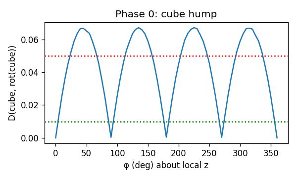
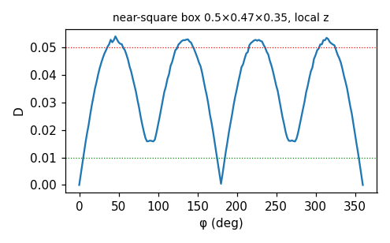
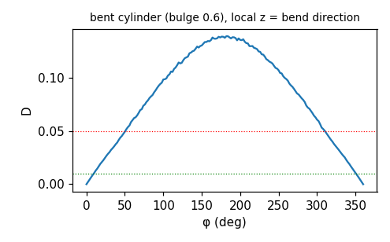
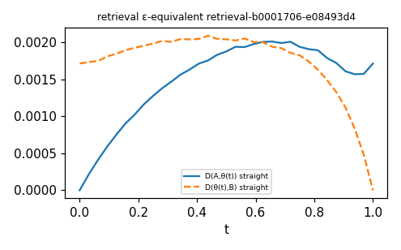
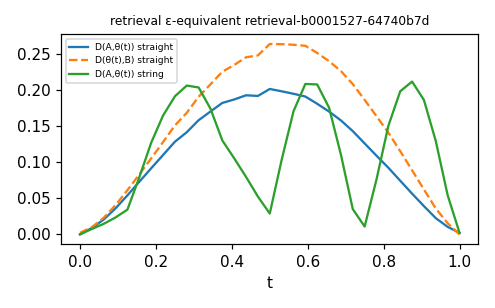
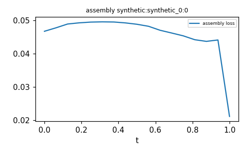
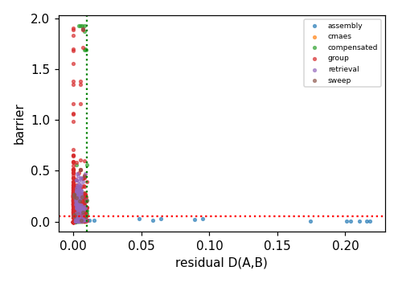
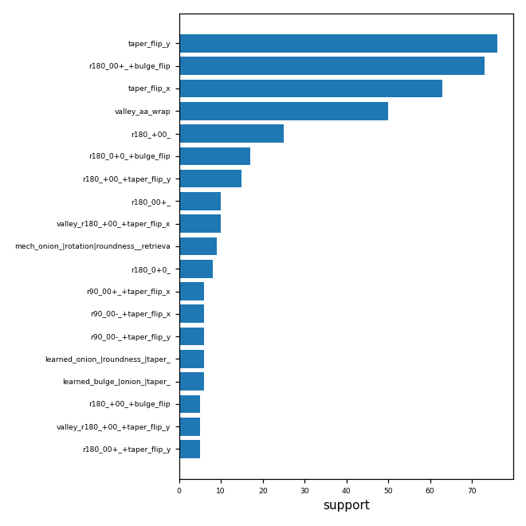

# Rewrite-pair search — run `20261109-2145-dcfa781`

Preset `dry`; ε_close=0.01, δ_hill=0.05, M=8192. Stubbed modules: ['cubvh', 'kaolin', 'kaolin.non_commercial', 'kaolin.non_commercial.flexicubes', 'fastsweep', 'cc3d', 'drjit', 'drjit.cuda', 'igl'].

**Notes / deviations:**
- Phase 4 ran on synthetic assemblies (no --toys4k_release_root given).

## Phase 0
```
{
 "raw_roundtrip_max_abs": 3.0994415283203125e-05,
 "cube_D_90": 0.00035829906119033694,
 "cube_D_45": 0.06666626781225204,
 "cube_90_identity_ok": true,
 "cube_45_hump_ok": true,
 "metric_rel_diff_M_vs_Mcheck": 0.008016384206712246,
 "metric_stable": true,
 "bulge_zero_singular": {
  "sdf_at_x0p4_bulge0": -0.0,
  "sdf_at_x0p4_bulge_1em3": 0.1501922607421875,
  "note": "sign(0)=0 in map_arc_bulge collapses x; samplers keep |bulge|>=1e-3"
 },
 "varaxis_fold_max_err": {
  "Y": 4.172325134277344e-07,
  "Z": 3.725290298461914e-07,
  "X": 4.917383193969727e-07
 },
 "varaxis_fold_ok": true
}
```

## Pairs per phase and kind

| phase | kind | n |
|---|---|---|
| assembly | approximate | 34 |
| assembly | exact | 2 |
| cmaes | degenerate_valley | 2 |
| compensated | approximate | 48 |
| compensated | conditional | 55 |
| compensated | degenerate_valley | 49 |
| compensated | exact | 30 |
| group | conditional | 339 |
| group | degenerate_valley | 82 |
| group | exact | 42 |
| retrieval | approximate | 87 |
| retrieval | conditional | 7 |
| retrieval | degenerate_valley | 39 |
| retrieval | exact | 2 |
| sweep | conditional | 18 |
| sweep | degenerate_valley | 1 |


Candidates (incl. near-misses) by failure reason:
| reason | n |
|---|---|
| qualified | 837 |
| d_geo>=eps_close | 363 |
| does_not_beat_baselines | 13 |


Threshold calibration: 171 near-misses with ε ≤ D < 2ε; 42 with ½δ < barrier ≤ δ. Large counts here mean the thresholds sit inside a population and should be revisited (record changes in config.json).


## Phase 1 transform classes (non-none)
| transform | cls | frac_close | hills |
|---|---|---|---|
| aa_wrap | exact | 1 | 0 |
| r180[00+]+bulge_flip | exact | 1 | 47 |
| taper_flip_x | conditional | 0.88 | 43 |
| taper_flip_y | conditional | 0.88 | 44 |
| r180[+00]+taper_flip_y | conditional | 0.36 | 15 |
| r180[+00] | conditional | 0.34 | 16 |
| r180[0+0]+bulge_flip | conditional | 0.34 | 17 |
| r180[+00]+taper_flip_x | conditional | 0.2381 | 0 |
| r180[00+]+taper_flip_x | conditional | 0.12 | 6 |
| r90[00+] | conditional | 0.12 | 4 |
| r180[00+]+taper_flip_y | conditional | 0.12 | 6 |
| r90[00+]+bulge_flip | conditional | 0.12 | 5 |
| r90[00+]+taper_flip_x | conditional | 0.12 | 6 |
| r90[00+]+taper_flip_y | conditional | 0.12 | 6 |
| r90[00-]+bulge_flip | conditional | 0.12 | 5 |
| r90[00-]+taper_flip_x | conditional | 0.12 | 6 |
| r90[00-] | conditional | 0.12 | 4 |
| r90[00-]+taper_flip_y | conditional | 0.12 | 6 |
| r180[00+] | conditional | 0.12 | 5 |
| r180[+-0]+taper_flip_y | conditional | 0.08 | 3 |
| r180[+-0] | conditional | 0.08 | 4 |
| r180[++0] | conditional | 0.08 | 4 |
| r180[+00]+bulge_flip | conditional | 0.08 | 4 |
| r180[+-0]+taper_flip_x | conditional | 0.08 | 3 |
| r180[+-0]+bulge_flip | conditional | 0.08 | 4 |
| r180[++0]+taper_flip_y | conditional | 0.08 | 3 |
| r180[++0]+taper_flip_x | conditional | 0.08 | 3 |
| r180[++0]+bulge_flip | conditional | 0.08 | 4 |
| r180[0+0]+taper_flip_x | conditional | 0.08 | 3 |
| r180[0+0] | conditional | 0.08 | 4 |
| sizeperm_yxz | conditional | 0.07143 | 0 |
| r120[-++] | conditional | 0.06 | 3 |
| r120[---]+taper_flip_x | conditional | 0.06 | 3 |
| r120[+-+] | conditional | 0.06 | 3 |
| r120[++-] | conditional | 0.06 | 3 |
| r120[---] | conditional | 0.06 | 3 |
| r180[+0+]+bulge_flip | conditional | 0.06 | 3 |
| r180[+0+]+taper_flip_x | conditional | 0.06 | 3 |
| r180[+0+]+taper_flip_y | conditional | 0.06 | 3 |
| r180[+0-]+bulge_flip | conditional | 0.06 | 3 |


## Top 10 rules by support
| rule_id | kind | map | support | mean_residual | mean_barrier | mean_delta_iou | topology_class | varaxis_covered | precondition |
|---|---|---|---|---|---|---|---|---|---|
| taper_flip_y | conditional | analytic | 76 | 0.001236 | 0.3789 |  | same | False | (taper > 0.3154 and thin <= 0.0524) or (taper > 0.3154 and thin > 0.0524) |
| r180_00+_+bulge_flip | exact | group | 73 | 0.001263 | 0.3774 |  | same | False |  |
| taper_flip_x | conditional | analytic | 63 | 0.0008976 | 0.3118 |  | same | False | (taper > 0.3154 and thin <= 0.0524) or (taper > 0.3154 and thin > 0.0524) |
| r180_+00_ | conditional | group | 25 | 0.00051 | 0.4456 |  | same | False | (taper_dev <= 0.0836) or (taper_dev > 0.0836 and inner_rel <= 0.0779) |
| r180_0+0_+bulge_flip | conditional | group | 17 | 0 | 0.4262 |  | None | False | (taper_dev <= 0.0836) or (taper_dev > 0.0836 and inner_rel <= 0.0779) |
| r180_+00_+taper_flip_y | conditional | analytic | 15 | 0 | 0.5426 |  | None | False | (taper_dev <= 0.0836) or (taper_dev > 0.0836 and inner_rel <= 0.0779) |
| r180_00+_ | conditional | group | 10 | 1.237e-08 | 0.1717 |  | same | False | (abs_bulge <= 0.0457) |
| mech_onion_|rotation|roundness__retrieval | approximate | learned_affine | 9 |  | 0.01411 | 0.06004 | same | False | (thin <= 0.0166) |
| r180_0+0_ | conditional | group | 8 | 1.009e-08 | 0.1503 |  | same | False | (abs_bulge <= 0.0131 and dilate_rel <= 0.018) |
| learned_onion_|roundness_|taper_ | approximate | learned_affine | 6 |  | 0.3183 |  | same | False | (abs_bulge <= 1.3015 and thin > 0.0317) |


## Top 10 rules by ΔIoU
| rule_id | kind | map | support | mean_residual | mean_barrier | mean_delta_iou | topology_class | varaxis_covered | precondition |
|---|---|---|---|---|---|---|---|---|---|
| mech_onion_|rotation|size_y__retrieval | approximate | learned_affine | 2 |  | 0.02433 | 0.2289 | same | False | (thin <= 0.0166) |
| mech_dilate_|onion_|rotation_retrieval | approximate | learned_affine | 2 |  | 0.01794 | 0.1524 | same | False | (thin <= 0.0166) |
| mech_dilate_|onion_|roundness__retrieval | approximate | learned_affine | 3 |  | 0.02051 | 0.1455 | same | False | (thin <= 0.0166) |
| prim_swap | exact | learned_affine | 2 |  |  | 0.1261 | same | False |  |
| mech_rotation|size_y_|size_z__rotation | approximate | analytic | 1 |  | 0.01878 | 0.07279 | same | False | (thin <= 0.0235) |
| mech_rotation|size_x_|size_y__rotation | approximate | analytic | 2 |  | 0.005168 | 0.06901 | same | False | (thin <= 0.0235) |
| mech_onion_|rotation|roundness__retrieval | approximate | learned_affine | 9 |  | 0.01411 | 0.06004 | same | False | (thin <= 0.0166) |
| mech_rotation|size_z_|taper__rotation | approximate | analytic | 1 |  | 0.01102 | 0.03593 | same | False | (thin <= 0.0235) |
| mech_dilate_|onion_|roundness__retrieval | approximate | learned_affine | 1 |  | 0.01101 | 0.03036 | same | False | (thin <= 0.0166) |
| mech_rotation|roundness_|size_y__rotation | approximate | analytic | 1 |  | 0.01168 | 0.01385 | same | False | (thin <= 0.0235) |


## Degenerate valleys (canonicalise, don't jump)
| rule_id | support | mean_d_geo | mean_barrier | mechanism_swap |
|---|---|---|---|---|
| valley_aa_wrap | 50 | 4.95e-08 | 5.374e-08 | [] |
| valley_r180_+00_+taper_flip_x | 10 | 0.006262 | 0.007955 | ['roundness↑', 'roundness↓', 'size_x↑', 'size_x↓', 'size_y↑', 'size_y↓'] |
| valley_r180_+00_+taper_flip_y | 5 | 0.001328 | 0.02752 | ['bulge↑', 'bulge↓', 'onion↑', 'rotation', 'roundness↑', 'roundness↓'] |
| valley_r90_00+_ | 4 | 0.001071 | 0.02473 | ['bulge↑', 'rotation', 'roundness↑', 'size_x↓', 'size_y↑'] |
| valley_mech_onion_|roundness_|taper__taper | 4 | 0.004348 | 0.004351 | ['onion↑', 'roundness↓', 'taper↑'] |
| valley_sizeperm_yxz | 3 | 0.007867 | 0.007863 | ['size_x↓', 'size_y↑'] |
| valley_mech_onion_|roundness_|taper__retrieval | 3 | 0.004368 | 0.008066 | ['onion↓', 'roundness↑', 'taper↑'] |
| valley_mech_onion_|roundness_|taper__retrieval | 3 | 0.006063 | 0.01005 | ['onion↑', 'roundness↓', 'taper↑'] |
| valley_mech_onion_|roundness_|taper__retrieval | 3 | 0.001949 | 0.00213 | ['onion↑', 'roundness↑', 'taper↓'] |
| valley_mech_onion_|roundness_|taper__taper | 3 | 0.002897 | 0.003775 | ['onion↑', 'roundness↓', 'taper↓'] |
| valley_mech_onion_|roundness_|taper__onion | 3 | 0.002087 | 0.002418 | ['onion↑', 'roundness↓', 'taper↓'] |
| valley_mech_dilate_|onion_|roundness__onion | 3 | 0.003398 | 0.003629 | ['dilate↑', 'onion↑', 'roundness↓'] |
| valley_r90_00-_ | 3 | 0.0007517 | 0.03081 | ['rotation', 'size_x↓', 'size_y↑'] |
| valley_mech_dilate_|onion_|roundness__onion | 3 | 0.003078 | 0.003078 | ['dilate↓', 'onion↓', 'roundness↑'] |
| valley_r180_00+_+bulge_flip | 2 | 0.001179 | 0.02281 | ['bulge↑', 'onion↑', 'rotation', 'roundness↓', 'taper↑'] |


## VarAxis baseline coverage
2 of 188 hill rules are reproduced by a VarAxis axis-class switch (cyclic permutation r120[±±±] with size permutation). The rest — 90°/180° rotations with size swaps, bulge/taper flips, learned cross-mechanism maps — are not reachable by VarAxis' Gumbel switch.

Covered: r120_---_, r120_+++_


## Mechanism-swap clusters (retrieval) × topology class
| sig | topology_class | n |
|---|---|---|
| onion↑|roundness↓|taper↑ | same | 6 |
| bulge↓|onion↑|taper↓ | same | 5 |
| onion↓|roundness↑|taper↓ | eps_equivalent | 4 |
| onion↓|roundness↑|taper↑ | same | 3 |
| bulge↓|onion↓|taper↑ | same | 3 |
| onion↓|roundness↓|taper↓ | same | 3 |
| bulge↓|onion↑|roundness↓ | same | 3 |
| onion↓|roundness↓|taper↑ | eps_equivalent | 3 |
| roundness↓|size_y↓|taper↑ | same | 3 |
| onion↑|roundness↓|taper↓ | same | 3 |
| onion↑|roundness↓|size_x↓ | same | 3 |
| onion↑|size_y↓|taper↑ | same | 2 |
| bulge↓|onion↓|roundness↓ | same | 2 |
| bulge↑|onion↓|roundness↑ | same | 2 |
| onion↓|roundness↑|taper↓ | same | 2 |
| onion↑|size_y↓|size_z↑ | eps_equivalent | 2 |
| onion↓|roundness↓|taper↑ | same | 2 |
| onion↑|roundness↑|taper↓ | same | 2 |
| bulge↓|roundness↓|taper↑ | same | 2 |
| roundness↑|size_y↓|size_z↑ | same | 2 |
| onion↑|roundness↓|taper↑ | different | 2 |
| onion↑|roundness↓|taper↑ | eps_equivalent | 2 |
| roundness↑|size_z↑|taper↑ | same | 2 |
| onion↑|roundness↑|taper↑ | same | 2 |
| bulge↑|onion↓|taper↑ | same | 2 |


## Held-out validation (known pairs, not used for tuning)
```
{
 "onion_annulus__bulge_ring": {
  "rank": 2,
  "residual": 0.0060854144394397736,
  "n_partner_like_in_bank": 582,
  "partner": [
   0.0,
   0.0,
   0.0,
   0.01829451695084572,
   0.012713541276752949,
   0.15846844017505646,
   0.9182276725769043,
   0.0449957512319088,
   1.4152873754501343,
   1.829269528388977,
   0.05579856038093567,
   0.0,
   0.0,
   0.0
  ],
  "retrieval_pairs_with_partner_mechanism": [
   "retrieval-b0001713-2a7b8ca0",
   "retrieval-b0000666-b4614310",
   "retrieval-b0001112-b99f21eb",
   "retrieval-b0004193-54995bb5",
   "retrieval-b0004193-06bc9b42",
   "retrieval-b0002225-7766421d",
   "retrieval-b0000575-4d56da5e",
   "retrieval-b0004193-ba292abf",
   "retrieval-b0000273-4dcf290f",
   "retrieval-b0000666-2dce3e0e",
   "retrieval-b0002225-76e675fd",
   "retrieval-b0002113-964cfc61"
  ]
 },
 "taper_flip": {
  "rank": 1,
  "residual": 0.004306082148104906,
  "n_partner_like_in_bank": 2113,
  "partner": [
   0.0,
   0.0,
   0.0,
   0.3644683063030243,
   0.4891825020313263,
   0.5522482991218567,
   0.9789950847625732,
   0.0007510634022764862,
   1.417087197303772,
   -0.01804651878774166,
   0.09345638751983643,
   0.0,
   0.0,
   0.0
  ],
  "retrieval_pairs_with_partner_mechanism": [
   "retrieval-b0004122-06bc9b42",
   "retrieval-b0001706-e08493d4",
   "retrieval-b0002641-232a7079",
   "retrieval-b0001527-64740b7d",
   "retrieval-b0001892-e6d67331",
   "retrieval-b0002635-2a7b8ca0",
   "retrieval-b0001713-2a7b8ca0",
   "retrieval-b0001892-8f212f1d",
   "retrieval-b0003182-7382dfea",
   "retrieval-b0000435-54995bb5",
   "retrieval-b0004122-29d5ed2a",
   "retrieval-b0000626-3f152a26",
   "retrieval-b0002695-11ef1a46",
   "retrieval-b0000823-41003246",
   "retrieval-b0000466-32876e3b",
   "retrieval-b0001892-54995bb5",
   "retrieval-b0001693-fb7b78eb",
   "retrieval-b0001665-0d84cd65",
   "retrieval-b0000857-4dcf290f",
   "retrieval-b0000666-b4614310"
  ]
 },
 "dilated_core_sphere__rounded_body": {
  "rank": null,
  "residual": null,
  "n_partner_like_in_bank": 577,
  "retrieval_pairs_with_partner_mechanism": [
   "retrieval-b0004544-e270d00a",
   "retrieval-b0002741-232a7079",
   "retrieval-b0001922-0dc5ad33",
   "retrieval-b0004122-29d5ed2a",
   "retrieval-b0000626-3f152a26",
   "retrieval-b0000435-ad036930",
   "retrieval-b0001665-0d84cd65",
   "retrieval-b0000857-4dcf290f",
   "retrieval-b0001922-5b596e71",
   "retrieval-b0003931-22c85606",
   "retrieval-b0000435-6575e7c8",
   "retrieval-b0000508-5ca6be16",
   "retrieval-b0004276-de7fe1d2",
   "retrieval-b0001255-bb17218c",
   "retrieval-b0000435-06bc9b42",
   "retrieval-b0003675-bf2e4414",
   "retrieval-b0001922-1c429507",
   "retrieval-b0001892-9e48c2e0",
   "retrieval-b0001606-64740b7d",
   "retrieval-b0001255-b5b3e984"
  ]
 }
}
```
Descriptor check on exact identities (recall of g(θ) among θ's neighbours):
```
{
 "r180[00+]+bulge_flip": {
  "recall_at_1": 0.625,
  "recall_at_5": 0.78125
 }
}
```


## Phase 4 assemblies
Target modes: {"synthetic_0": "synthetic_true_assembly", "synthetic_1": "synthetic_true_assembly", "synthetic_2": "synthetic_true_assembly", "synthetic_3": "synthetic_true_assembly", "synthetic_4": "synthetic_true_assembly"}


Opportunities that beat continued descent and the VarAxis baseline, by category:
| category | driver | n | mean_delta_iou | mean_delta_loss |
|---|---|---|---|---|
| synthetic | prim_swap | 2 | 0.1261 | -0.005653 |
| synthetic | retrieval | 27 | 0.06259 | -0.004645 |
| synthetic | rotation | 7 | 0.03599 | -0.004923 |


Extraction checks: [{"name": "synthetic_0", "check": {"max_err": 0.0}}, {"name": "synthetic_1", "check": {"max_err": 0.0}}, {"name": "synthetic_2", "check": {"max_err": 0.0}}, {"name": "synthetic_3", "check": {"max_err": 0.0}}, {"name": "synthetic_4", "check": {"max_err": 0.0}}]


## Figures
- cube: 
- near_square_box: 
- bent_cylinder: 
- eps_equivalent_0: 
- eps_equivalent_1: 
- toys4k_primitive: 
- barrier_vs_residual: 
- rule_coverage: 


## Open questions
- Are the ε/δ thresholds well placed? See the calibration line above and candidates.parquet.
- Straight-line vs string barriers: pairs where barrier_neb ≪ barrier have a low curved path and may not need a rewrite.
- Learned (affine) maps are first-order; check residual after the local refine before relying on them.
