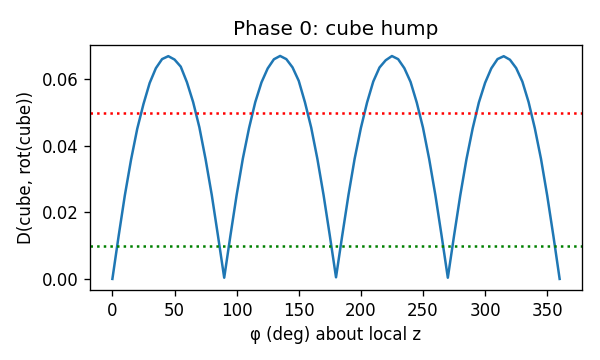
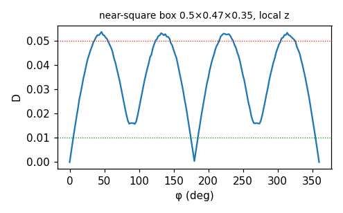
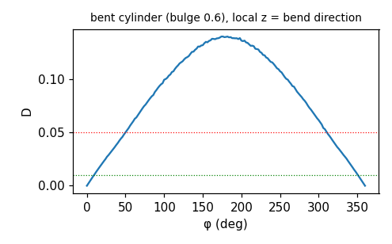
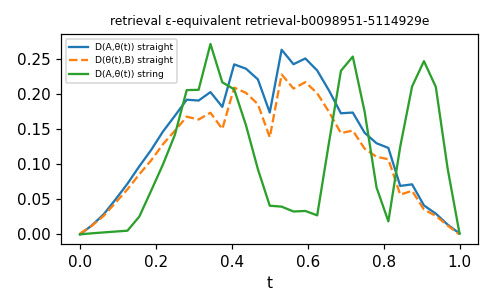
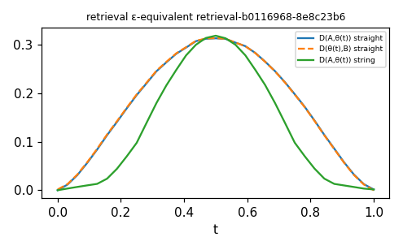
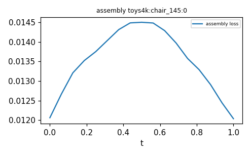
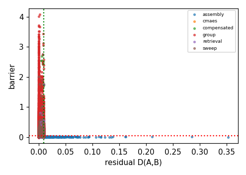
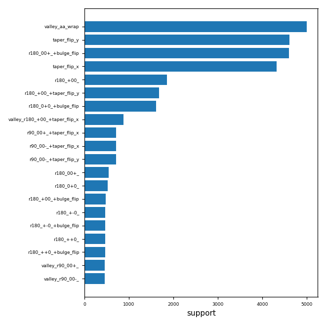

# Rewrite-pair search — run `20261109-2358-9c3c3aa`

Preset `full`; ε_close=0.01, δ_hill=0.05, M=32768. Stubbed modules: ['cubvh', 'kaolin', 'kaolin.non_commercial', 'kaolin.non_commercial.flexicubes', 'fastsweep', 'cc3d', 'drjit', 'drjit.cuda', 'igl'].

## Phase 0
```
{
 "raw_roundtrip_max_abs": 3.0994415283203125e-05,
 "cube_D_90": 0.0003614761517383158,
 "cube_D_45": 0.06700478494167328,
 "cube_90_identity_ok": true,
 "cube_45_hump_ok": true,
 "metric_rel_diff_M_vs_Mcheck": 0.006230207160115242,
 "metric_stable": true,
 "bulge_zero_singular": {
  "sdf_at_x0p4_bulge0": -0.0,
  "sdf_at_x0p4_bulge_1em3": 0.1501922607421875,
  "note": "sign(0)=0 in map_arc_bulge collapses x; samplers keep |bulge|>=1e-3"
 },
 "varaxis_fold_max_err": {
  "Y": 4.172325134277344e-07,
  "Z": 3.725290298461914e-07,
  "X": 4.917383193969727e-07
 },
 "varaxis_fold_ok": true
}
```

## Pairs per phase and kind

| phase | kind | n |
|---|---|---|
| assembly | approximate | 940 |
| assembly | exact | 156 |
| cmaes | degenerate_valley | 9 |
| compensated | approximate | 722 |
| compensated | conditional | 907 |
| compensated | degenerate_valley | 645 |
| compensated | exact | 388 |
| group | conditional | 30615 |
| group | degenerate_valley | 8475 |
| group | exact | 4201 |
| retrieval | approximate | 981 |
| retrieval | conditional | 130 |
| retrieval | degenerate_valley | 699 |
| retrieval | exact | 127 |
| sweep | conditional | 345 |
| sweep | degenerate_valley | 55 |


Candidates (incl. near-misses) by failure reason:
| reason | n |
|---|---|
| qualified | 49395 |
| d_geo>=eps_close | 32162 |
| does_not_beat_baselines | 2834 |
| gd_crosses | 76 |


Threshold calibration: 16759 near-misses with ε ≤ D < 2ε; 2756 with ½δ < barrier ≤ δ. Large counts here mean the thresholds sit inside a population and should be revisited (record changes in config.json).


## Phase 1 transform classes (non-none)
| transform | cls | frac_close | hills |
|---|---|---|---|
| aa_wrap | exact | 1 | 0 |
| r180[00+]+bulge_flip | exact | 1 | 4925 |
| taper_flip_y | conditional | 0.8418 | 4209 |
| taper_flip_x | conditional | 0.8418 | 4110 |
| r180[+00]+taper_flip_y | conditional | 0.3402 | 1644 |
| r180[0+0]+bulge_flip | conditional | 0.3328 | 1667 |
| r180[+00] | conditional | 0.3324 | 1616 |
| r180[+00]+taper_flip_x | conditional | 0.2086 | 2 |
| r180[00+] | conditional | 0.168 | 454 |
| r90[00-]+bulge_flip | conditional | 0.1676 | 759 |
| r90[00+] | conditional | 0.1676 | 390 |
| r90[00+]+bulge_flip | conditional | 0.1674 | 760 |
| r90[00-] | conditional | 0.1672 | 389 |
| r180[00+]+taper_flip_y | conditional | 0.1524 | 761 |
| r180[00+]+taper_flip_x | conditional | 0.1522 | 701 |
| r90[00-]+taper_flip_y | conditional | 0.1518 | 758 |
| r90[00+]+taper_flip_x | conditional | 0.1518 | 758 |
| r90[00+]+taper_flip_y | conditional | 0.1518 | 759 |
| r90[00-]+taper_flip_x | conditional | 0.1516 | 758 |
| r180[0+0]+taper_flip_x | conditional | 0.0944 | 240 |
| r180[+-0]+taper_flip_y | conditional | 0.094 | 414 |
| r180[+-0]+taper_flip_x | conditional | 0.094 | 208 |
| r180[++0]+taper_flip_y | conditional | 0.094 | 412 |
| r180[++0]+taper_flip_x | conditional | 0.094 | 210 |
| r180[0+0] | conditional | 0.0938 | 429 |
| r180[+00]+bulge_flip | conditional | 0.0936 | 468 |
| r180[++0]+bulge_flip | conditional | 0.0934 | 468 |
| r180[++0] | conditional | 0.0932 | 468 |
| r180[+-0] | conditional | 0.0932 | 469 |
| r180[+-0]+bulge_flip | conditional | 0.0932 | 470 |
| sizeperm_zyx | conditional | 0.05276 | 0 |
| r90[0+0]+bulge_flip | conditional | 0.0414 | 207 |
| r180[+0-] | conditional | 0.0414 | 207 |
| r90[0-0]+bulge_flip | conditional | 0.041 | 204 |
| r90[0-0]+taper_flip_y | conditional | 0.0408 | 204 |
| r90[0+0]+taper_flip_y | conditional | 0.0408 | 203 |
| r90[0-0] | conditional | 0.0408 | 163 |
| r180[+0-]+bulge_flip | conditional | 0.0406 | 203 |
| r90[0+0]+taper_flip_x | conditional | 0.0406 | 203 |
| r90[+00]+taper_flip_y | conditional | 0.0406 | 203 |


## Top 10 rules by support
| rule_id | kind | map | support | mean_residual | mean_barrier | mean_delta_iou | topology_class | varaxis_covered | precondition |
|---|---|---|---|---|---|---|---|---|---|
| taper_flip_y | conditional | analytic | 4609 | 0.0003229 | 0.31 |  | same | False | (taper <= 0.477 and inner_rel <= 0.0383) or (taper > 0.477 and round_minus_inset <= -0.2246) or (taper > 0.477 and round_minus_inset > -0.2246) |
| r180_00+_+bulge_flip | exact | group | 4604 | 0.000311 | 0.3612 |  | same | False |  |
| taper_flip_x | conditional | analytic | 4323 | 0.0001989 | 0.256 |  | same | False | (taper <= 0.477 and inner_rel <= 0.0383) or (taper > 0.477 and round_minus_inset <= -0.2246) or (taper > 0.477 and round_minus_inset > -0.2246) |
| r180_+00_ | conditional | group | 1857 | 0.0001551 | 0.2674 |  | same | False | (taper_dev <= 0.1797 and taper_dev <= 0.0742) or (taper_dev <= 0.1797 and taper_dev > 0.0742) or (taper_dev > 0.1797 and inner_rel <= 0.0608) |
| r180_+00_+taper_flip_y | conditional | analytic | 1683 | 0.0001058 | 0.3177 |  | same | False | (taper_dev <= 0.2243 and taper_dev <= 0.0742) or (taper_dev <= 0.2243 and taper_dev > 0.0742) or (taper_dev > 0.2243 and inner_rel <= 0.0532) |
| r180_0+0_+bulge_flip | conditional | group | 1607 | 7.074e-05 | 0.3024 |  | same | False | (taper_dev <= 0.1797 and taper_dev <= 0.0742) or (taper_dev <= 0.1797 and taper_dev > 0.0742) or (taper_dev > 0.1797 and inner_rel <= 0.0608) |
| r90_00+_+taper_flip_x | conditional | analytic | 713 | 0 | 0.1645 |  | same | False | (abs_bulge <= 0.0446 and taper > 0.3791) |
| r90_00-_+taper_flip_x | conditional | analytic | 713 | 0 | 0.1643 |  | same | False | (abs_bulge <= 0.0446 and taper > 0.3791) |
| r90_00-_+taper_flip_y | conditional | analytic | 713 | 0 | 0.223 |  | same | False | (abs_bulge <= 0.0446 and taper > 0.3791) |
| r180_00+_ | conditional | group | 544 | 7.45e-05 | 0.1459 |  | same | False | (abs_bulge <= 0.0562 and abs_bulge <= 0.0238) or (abs_bulge <= 0.0562 and abs_bulge > 0.0238) |


## Top 10 rules by ΔIoU
| rule_id | kind | map | support | mean_residual | mean_barrier | mean_delta_iou | topology_class | varaxis_covered | precondition |
|---|---|---|---|---|---|---|---|---|---|
| mech_rotation|roundness_|size_x__rotation | approximate | analytic | 10 |  | 0.06269 | 0.01338 | same | False | (taper_dev <= 0.0017 and aniso_yz <= 0.4824) |
| mech_rotation|roundness_|size_x__retrieval | approximate | learned_affine | 2 |  | 0.00178 | 0.01338 | same | False | (aniso_yz <= 0.0111) |
| mech_onion_|rotation|size_x__retrieval | approximate | learned_affine | 5 |  | 0.002863 | 0.01153 | same | False | (aniso_yz <= 0.0111) |
| mech_rotation|size_y_|taper__rotation | approximate | analytic | 1 |  | 0.001251 | 0.0114 | same | False | (thin <= 0.0212) |
| mech_rotation|size_x_|taper__rotation | approximate | analytic | 4 |  | 0.1711 | 0.01062 | same | False | (taper <= 0.5769 and taper_dev <= 0.5437) |
| mech_dilate_|onion_|roundness__dilate | approximate | learned_affine | 1 |  | 0.0005469 | 0.01061 | different | False | (thin <= 0.0382) |
| mech_bulge_|rotation|size_x__rotation | approximate | analytic | 4 |  | 0.007787 | 0.01016 | same | False | (thin <= 0.0212) |
| mech_rotation|roundness_|size_x__retrieval | approximate | learned_affine | 1 |  | 0.01144 | 0.009627 | same | False | (aniso_yz <= 0.0111) |
| mech_onion_|rotation|size_y__retrieval | approximate | learned_affine | 1 |  | 0.003668 | 0.009192 | same | False | (aniso_yz <= 0.0111) |
| mech_onion_|rotation|size_x__rotation | approximate | analytic | 1 |  | 0.001213 | 0.009192 | same | False | (thin <= 0.0212) |


## Degenerate valleys (canonicalise, don't jump)
| rule_id | support | mean_d_geo | mean_barrier | mechanism_swap |
|---|---|---|---|---|
| valley_aa_wrap | 5000 | 4.272e-08 | 8.211e-08 | ['rotation'] |
| valley_r180_+00_+taper_flip_x | 877 | 0.005506 | 0.006369 | ['onion↑', 'onion↓', 'roundness↑', 'roundness↓', 'size_x↑', 'size_x↓'] |
| valley_r90_00+_ | 458 | 0.0006891 | 0.0235 | ['bulge↑', 'onion↓', 'rotation', 'roundness↑', 'size_x↑', 'size_x↓'] |
| valley_r90_00-_ | 457 | 0.0006913 | 0.02364 | ['onion↓', 'rotation', 'roundness↑', 'roundness↓', 'size_x↑', 'size_x↓'] |
| valley_r180_00+_ | 408 | 0.0007443 | 0.02234 | ['onion↑', 'onion↓', 'rotation', 'roundness↑', 'roundness↓', 'size_x↑'] |
| valley_sizeperm_zyx | 243 | 0.005606 | 0.006548 | ['rotation', 'size_x↑', 'size_x↓', 'size_z↑', 'size_z↓'] |
| valley_sizeperm_yxz | 133 | 0.006241 | 0.006254 | ['size_x↑', 'size_x↓', 'size_y↑', 'size_y↓'] |
| valley_taper_flip_x | 97 | 0.0002105 | 0.03417 | ['rotation', 'roundness↑', 'roundness↓', 'size_x↑', 'size_x↓', 'size_y↑'] |
| valley_sizeperm_xzy | 86 | 0.005452 | 0.005459 | ['rotation', 'size_y↑', 'size_y↓', 'size_z↑', 'size_z↓'] |
| valley_r180_+00_+taper_flip_y | 68 | 0.002136 | 0.03203 | ['bulge↑', 'bulge↓', 'dilate↑', 'onion↑', 'rotation', 'roundness↑'] |
| valley_r180_++0_+taper_flip_y | 65 | 0.001952 | 0.03202 | ['bulge↑', 'bulge↓', 'onion↓', 'rotation', 'roundness↑', 'roundness↓'] |
| valley_r180_+-0_+taper_flip_y | 62 | 0.001936 | 0.03148 | ['bulge↑', 'bulge↓', 'rotation', 'roundness↑', 'roundness↓', 'size_x↑'] |
| valley_r180_+00_ | 61 | 0.002106 | 0.02828 | ['onion↑', 'onion↓', 'rotation', 'roundness↑', 'roundness↓', 'taper↑'] |
| valley_r180_00+_+bulge_flip | 58 | 0.0007494 | 0.03325 | ['bulge↑', 'bulge↓', 'onion↑', 'onion↓', 'rotation', 'roundness↑'] |
| valley_taper_flip_y | 48 | 0.00226 | 0.01926 | ['bulge↑', 'bulge↓', 'onion↑', 'onion↓', 'rotation', 'roundness↑'] |


## VarAxis baseline coverage
2 of 455 hill rules are reproduced by a VarAxis axis-class switch (cyclic permutation r120[±±±] with size permutation). The rest — 90°/180° rotations with size swaps, bulge/taper flips, learned cross-mechanism maps — are not reachable by VarAxis' Gumbel switch.

Covered: r120_+++_, r120_---_


## Mechanism-swap clusters (retrieval) × topology class
| sig | topology_class | n |
|---|---|---|
| onion↓|roundness↓|taper↑ | same | 67 |
| bulge↓|onion↑|roundness↓ | same | 64 |
| bulge↑|onion↓|taper↑ | same | 55 |
| onion↑|roundness↓|taper↑ | same | 55 |
| bulge↑|onion↓|roundness↑ | same | 50 |
| bulge↑|roundness↓|taper↑ | same | 49 |
| onion↓|roundness↑|taper↑ | same | 48 |
| onion↑|roundness↑|taper↓ | same | 43 |
| bulge↑|onion↑|roundness↓ | same | 42 |
| bulge↑|onion↑|roundness↓ | eps_equivalent | 42 |
| bulge↑|roundness↓|taper↑ | eps_equivalent | 39 |
| bulge↓|roundness↓|taper↑ | same | 39 |
| bulge↓|onion↑|roundness↓ | eps_equivalent | 35 |
| onion↓|roundness↑|taper↓ | same | 33 |
| onion↑|roundness↓|taper↑ | eps_equivalent | 32 |
| bulge↓|onion↓|taper↑ | same | 32 |
| onion↑|roundness↓|taper↓ | same | 32 |
| bulge↓|onion↓|roundness↑ | same | 31 |
| onion↑|roundness↑|taper↓ | eps_equivalent | 29 |
| onion↓|roundness↓|taper↑ | eps_equivalent | 29 |
| bulge↓|roundness↓|taper↑ | eps_equivalent | 28 |
| bulge↑|roundness↑|taper↑ | same | 25 |
| dilate↑|onion↑|roundness↓ | same | 24 |
| onion↓|roundness↑|taper↑ | eps_equivalent | 24 |
| bulge↓|onion↑|taper↓ | same | 23 |


## Held-out validation (known pairs, not used for tuning)
```
{
 "onion_annulus__bulge_ring": {
  "rank": 1,
  "residual": 0.007540143560618162,
  "n_partner_like_in_bank": 23455,
  "partner": [
   0.0,
   0.0,
   0.0,
   0.06264189630746841,
   0.02428322844207287,
   0.13660213351249695,
   0.9937156438827515,
   0.029894676059484482,
   0.7806244492530823,
   1.8511226177215576,
   0.004645109176635742,
   0.0,
   0.0,
   0.0
  ],
  "retrieval_pairs_with_partner_mechanism": [
   "retrieval-b0010635-74328436",
   "retrieval-b0022678-fb2bcac4",
   "retrieval-b0156855-a333a313",
   "retrieval-b0037488-33143595",
   "retrieval-b0051052-33143595",
   "retrieval-b0156855-a7ab8372",
   "retrieval-b0022678-25338170",
   "retrieval-b0059144-a4a844a2",
   "retrieval-b0062672-33143595",
   "retrieval-b0035232-c4861418",
   "retrieval-b0075008-8bb51f0c",
   "retrieval-b0156855-6b88cfa9",
   "retrieval-b0152222-ff4b1469",
   "retrieval-b0129183-6abfd286",
   "retrieval-b0005541-0b1f5919",
   "retrieval-b0131872-757c25be",
   "retrieval-b0055289-60dc1ad3",
   "retrieval-b0022678-56b939a1",
   "retrieval-b0075148-68114fe9",
   "retrieval-b0008472-53dde70a"
  ]
 },
 "taper_flip": {
  "rank": 1,
  "residual": 0.004788717720657587,
  "n_partner_like_in_bank": 83328,
  "partner": [
   0.0,
   0.0,
   0.0,
   0.4095593988895416,
   0.37294647097587585,
   0.5068423748016357,
   0.7613700032234192,
   0.02715419977903366,
   1.3679862022399902,
   0.008444048464298248,
   0.18001589179039001,
   0.0,
   0.0,
   0.0
  ],
  "retrieval_pairs_with_partner_mechanism": [
   "retrieval-b0139487-882241dc",
   "retrieval-b0116968-8e8c23b6",
   "retrieval-b0136584-8e0a58ac",
   "retrieval-b0138153-d0cc38f9",
   "retrieval-b0082198-d8ec7936",
   "retrieval-b0093421-60867608",
   "retrieval-b0125934-a251be1d",
   "retrieval-b0104634-60867608",
   "retrieval-b0110717-f3956f38",
   "retrieval-b0146303-8e0a58ac",
   "retrieval-b0127037-c35433db",
   "retrieval-b0099321-f3956f38",
   "retrieval-b0004937-41349be3",
   "retrieval-b0081221-c298dcd6",
   "retrieval-b0001761-854e82ac",
   "retrieval-b0078244-dce52779",
   "retrieval-b0014531-23b8450b",
   "retrieval-b0126142-d7abfd9e",
   "retrieval-b0178263-00df2d17",
   "retrieval-b0163588-bb5635be"
  ]
 },
 "dilated_core_sphere__rounded_body": {
  "rank": null,
  "residual": null,
  "n_partner_like_in_bank": 23930,
  "retrieval_pairs_with_partner_mechanism": [
   "retrieval-b0098951-5114929e",
   "retrieval-b0136762-d2cbc993",
   "retrieval-b0110717-f3956f38",
   "retrieval-b0146303-8e0a58ac",
   "retrieval-b0009616-f36b6d7c",
   "retrieval-b0054142-bd6faf02",
   "retrieval-b0059144-85e0a5dd",
   "retrieval-b0059144-2b7b2dfa",
   "retrieval-b0078244-dce52779",
   "retrieval-b0057236-ec93d20d",
   "retrieval-b0010635-74328436",
   "retrieval-b0108175-1dc3526d",
   "retrieval-b0054142-f3956f38",
   "retrieval-b0102975-d33351e1",
   "retrieval-b0091156-4e3bc8a1",
   "retrieval-b0095476-531b4e23",
   "retrieval-b0101204-38a08687",
   "retrieval-b0054142-3e7ab4ae",
   "retrieval-b0057236-e1a6934a",
   "retrieval-b0152468-7a485741"
  ]
 }
}
```
Descriptor check on exact identities (recall of g(θ) among θ's neighbours):
```
{
 "r180[00+]+bulge_flip": {
  "recall_at_1": 0.359375,
  "recall_at_5": 0.53125
 }
}
```


## Phase 4 assemblies
Target modes: {"chair_145": "proxy_self_occupancy", "mug_087": "proxy_self_occupancy", "cup_009": "proxy_self_occupancy", "bowl_005": "proxy_self_occupancy", "bottle_035": "proxy_self_occupancy", "hat_015": "proxy_self_occupancy", "glass_057": "proxy_self_occupancy", "helmet_004": "proxy_self_occupancy", "snake_015": "proxy_self_occupancy", "sofa_016": "proxy_self_occupancy", "airplane_031": "proxy_self_occupancy", "apple_045": "proxy_self_occupancy", "ball_025": "proxy_self_occupancy", "banana_003": "proxy_self_occupancy", "bicycle_012": "proxy_self_occupancy", "boat_024": "proxy_self_occupancy", "bread_008": "proxy_self_occupancy", "bunny_022": "proxy_self_occupancy", "bus_015": "proxy_self_occupancy", "butterfly_001": "proxy_self_occupancy", "cake_038": "proxy_self_occupancy", "candy_011": "proxy_self_occupancy", "car_016": "proxy_self_occupancy", "cat_037": "proxy_self_occupancy", "cells_battery_034": "proxy_self_occupancy", "chess_piece_028": "proxy_self_occupancy", "chicken_007": "proxy_self_occupancy", "closet_014": "proxy_self_occupancy", "coin_025": "proxy_self_occupancy", "cookie_009": "proxy_self_occupancy", "cow_023": "proxy_self_occupancy", "crab_020": "proxy_self_occupancy", "cupcake_007": "proxy_self_occupancy", "deer_moose_009": "proxy_self_occupancy", "dinosaur_007": "proxy_self_occupancy", "dog_068": "proxy_self_occupancy", "dolphin_002": "proxy_self_occupancy", "donut_028": "proxy_self_occupancy", "dragon_006": "proxy_self_occupancy", "drum_005": "proxy_self_occupancy", "elephant_005": "proxy_self_occupancy", "fan_020": "proxy_self_occupancy", "fish_019": "proxy_self_occupancy", "flower_021": "proxy_self_occupancy", "fox_055": "proxy_self_occupancy", "fridge_018": "proxy_self_occupancy", "fries_003": "proxy_self_occupancy", "frog_025": "proxy_self_occupancy", "giraffe_005": "proxy_self_occupancy", "grapes_012": "proxy_self_occupancy"}

**Proxy target**: Toys4K meshes were not available, so the loss target is the released assembly's own occupancy. Under the proxy the fit is already optimal, so ΔIoU measures equal-loss alternatives, not improvements.


Opportunities that beat continued descent and the VarAxis baseline, by category:
| category | driver | n | mean_delta_iou | mean_delta_loss |
|---|---|---|---|---|
| airplane | prim_swap | 1 | 0.002808 | -2.742e-06 |
| airplane | retrieval | 1 | -0.002792 | -1.203e-06 |
| airplane | rotation | 1 | 0 | -2.155e-06 |
| apple | retrieval | 7 | -0.0001255 | -7.93e-06 |
| apple | rotation | 9 | -5.853e-05 | -3.02e-06 |
| ball | prim_swap | 4 | 0.0002164 | -1.021e-05 |
| ball | retrieval | 7 | 0.0007213 | -2.064e-05 |
| ball | rotation | 12 | 0.0006308 | -2.031e-05 |
| banana | retrieval | 6 | -0.000682 | -3.187e-05 |
| banana | rotation | 1 | 0 | -6.046e-06 |
| bicycle | prim_swap | 3 | 0 | -2.836e-06 |
| bicycle | retrieval | 1 | 0 | -4.478e-06 |
| bicycle | rotation | 1 | 0 | -2.166e-06 |
| boat | prim_swap | 11 | 0.004454 | -3.125e-05 |
| boat | retrieval | 25 | 0.003846 | -2.906e-05 |
| boat | rotation | 21 | 0.003777 | -3.255e-05 |
| bottle | bulge | 1 | 3.576e-06 | -4.782e-06 |
| bottle | prim_swap | 10 | 0.0004757 | -4.479e-06 |
| bottle | retrieval | 31 | 0.0004051 | -5.615e-06 |
| bottle | rotation | 24 | 0.0003969 | -5.834e-06 |
| bowl | prim_swap | 1 | 0.001088 | -7.185e-06 |
| bowl | retrieval | 11 | -0.0005763 | -8.533e-06 |
| bowl | rotation | 8 | -0.000533 | -1.225e-05 |
| bread | dilate | 1 | 7.057e-05 | -5.046e-06 |
| bread | retrieval | 6 | -0.000117 | -3.664e-06 |
| bread | rotation | 7 | -0.0001306 | -3.048e-06 |
| bunny | retrieval | 18 | -2.246e-05 | -2.88e-06 |
| bunny | rotation | 6 | 0 | -2.723e-06 |
| bus | prim_swap | 2 | -0.0003248 | -1.737e-06 |
| bus | retrieval | 2 | -0.0005195 | -1.651e-06 |
| butterfly | prim_swap | 1 | 0 | -5.292e-06 |
| butterfly | retrieval | 3 | 0 | -1.327e-06 |
| butterfly | rotation | 1 | 0 | -1.49e-05 |
| cake | prim_swap | 1 | 0.0003155 | -4.521e-06 |
| cake | retrieval | 18 | -3.543e-05 | -4.335e-06 |
| cake | rotation | 11 | -5.848e-05 | -5.356e-06 |
| candy | rotation | 3 | 0 | -1.566e-06 |
| car | prim_swap | 6 | 0.0007891 | -6.438e-05 |
| car | retrieval | 7 | 0.0002459 | -9.055e-05 |
| car | rotation | 9 | 0.0007661 | -8.244e-05 |
| cat | prim_swap | 2 | 0.0004536 | -6.644e-06 |
| cat | retrieval | 4 | -0.0002264 | -4.143e-06 |
| cat | rotation | 1 | -0.0003035 | -1.532e-06 |
| cells_battery | retrieval | 1 | 0.0007628 | -8.094e-05 |
| cells_battery | rotation | 1 | 0 | -0.0001457 |
| chair | prim_swap | 2 | 0.0009677 | -2.366e-05 |
| chair | retrieval | 21 | -9.282e-05 | -7.283e-06 |
| chair | rotation | 19 | 0 | -7.931e-06 |
| chess_piece | retrieval | 1 | -0.0004945 | -8.075e-06 |
| chicken | prim_swap | 3 | 0.002361 | -1.913e-05 |
| chicken | retrieval | 13 | -0.0003584 | -4.914e-06 |
| chicken | rotation | 11 | 0.0006335 | -2.937e-06 |
| closet | retrieval | 2 | -0.001313 | -8.253e-06 |
| closet | rotation | 1 | -0.0009881 | -7.936e-06 |
| coin | dilate | 1 | 0.0007865 | -1.489e-06 |
| coin | prim_swap | 2 | 0 | -2.376e-06 |
| coin | retrieval | 11 | 0.0002153 | -7.073e-06 |
| coin | rotation | 4 | 0.0002968 | -5.956e-06 |
| cookie | dilate | 1 | -0.0002984 | -1.762e-06 |
| cookie | prim_swap | 1 | -1.967e-06 | -2.347e-06 |
| cookie | retrieval | 6 | -0.0009428 | -1.321e-05 |
| cookie | rotation | 4 | -0.0005963 | -1.28e-05 |
| cow | prim_swap | 13 | 0.01298 | -0.0001489 |
| cow | retrieval | 15 | 0.01326 | -0.0001488 |
| cow | rotation | 18 | 0.01312 | -0.0001612 |
| crab | prim_swap | 2 | 0.0005388 | -4.044e-06 |
| crab | retrieval | 27 | 0.0002396 | -4.296e-06 |
| crab | rotation | 6 | 0.0005388 | -3.994e-06 |
| cup | retrieval | 2 | 0.0002559 | -2.114e-05 |
| cup | rotation | 4 | -0.0001922 | -2.767e-06 |
| cupcake | prim_swap | 1 | 0.0006281 | -1.731e-06 |
| cupcake | retrieval | 19 | -0.000187 | -1.417e-05 |
| cupcake | rotation | 5 | -0.0001668 | -6.395e-06 |
| deer_moose | retrieval | 12 | 0.002317 | -5.852e-06 |
| deer_moose | rotation | 5 | 0.001191 | -1.51e-06 |
| dinosaur | prim_swap | 4 | 0 | -4.394e-06 |
| dinosaur | retrieval | 21 | -0.001388 | -9.365e-06 |
| dinosaur | rotation | 2 | 0 | -7.304e-06 |
| dog | dilate | 1 | 0 | -2.123e-06 |
| dog | prim_swap | 2 | -0.0005078 | -1.118e-06 |
| dog | retrieval | 15 | 0.0001357 | -3.647e-06 |
| dog | rotation | 7 | 0 | -3.075e-06 |
| dolphin | retrieval | 2 | 0.002415 | -9.042e-06 |
| dolphin | rotation | 1 | 0.002415 | -1.608e-06 |
| donut | prim_swap | 1 | -0.001003 | -3.971e-06 |
| donut | retrieval | 13 | -0.0002161 | -3.283e-06 |
| donut | rotation | 4 | -0.0001005 | -1.508e-06 |
| dragon | prim_swap | 4 | -0.001017 | -5.046e-06 |
| dragon | retrieval | 14 | 0.0002952 | -2.677e-06 |
| dragon | rotation | 7 | 0 | -2.464e-06 |
| elephant | prim_swap | 4 | 0.0001895 | -5.211e-06 |
| elephant | retrieval | 19 | 0.0001985 | -5.82e-06 |
| elephant | rotation | 12 | 0.0001263 | -7.429e-06 |
| fan | prim_swap | 1 | 0 | -3.651e-06 |
| fan | retrieval | 1 | 0 | -2.059e-05 |
| fish | retrieval | 2 | 0 | -1.086e-06 |
| fish | rotation | 1 | 0.001357 | -1.261e-06 |
| flower | prim_swap | 10 | 0.001923 | -8.646e-06 |
| flower | retrieval | 57 | 0.001524 | -8.987e-06 |
| flower | rotation | 29 | 0.001456 | -8.374e-06 |
| fox | prim_swap | 2 | -0.002249 | -3.931e-06 |
| fox | retrieval | 28 | -0.0003951 | -1.171e-05 |
| fox | rotation | 9 | -0.0006378 | -4.25e-06 |
| fridge | retrieval | 1 | -0.0008944 | -6.216e-06 |
| fridge | rotation | 1 | 0 | -2.941e-06 |
| fries | prim_swap | 1 | -0.002073 | -3.801e-06 |
| fries | rotation | 3 | 0.0008281 | -2.061e-06 |
| frog | prim_swap | 1 | -0.001371 | -1.435e-06 |
| frog | retrieval | 4 | 0.0001145 | -3.975e-06 |
| giraffe | prim_swap | 14 | 0.008757 | -3.153e-05 |
| giraffe | retrieval | 25 | 0.007601 | -3.15e-05 |
| giraffe | rotation | 15 | 0.008785 | -4.131e-05 |
| glass | prim_swap | 13 | 0.005125 | -8.957e-05 |
| glass | retrieval | 18 | 0.001533 | -0.0001912 |
| glass | rotation | 5 | -0.001813 | -2.763e-05 |
| glass | taper | 1 | -0.002028 | -0.0004392 |
| grapes | dilate | 1 | 0.0005339 | -0.0002231 |
| grapes | prim_swap | 8 | 0.0003982 | -1.753e-05 |
| grapes | retrieval | 40 | 0.0008905 | -3.637e-05 |
| grapes | rotation | 9 | 0.0009172 | -4.466e-06 |
| hat | retrieval | 2 | 0.0005158 | -6.794e-06 |
| hat | rotation | 4 | 0 | -1.88e-06 |
| helmet | prim_swap | 2 | 0.0005304 | -1.437e-06 |
| helmet | retrieval | 25 | 0.0004348 | -2.839e-06 |
| helmet | rotation | 14 | 0.0004288 | -2.122e-06 |
| mug | retrieval | 1 | 0.001063 | -3.346e-06 |
| mug | rotation | 1 | 0.001086 | -6.47e-06 |
| snake | prim_swap | 1 | 0 | -1.436e-05 |
| snake | retrieval | 10 | 0 | -2.453e-05 |
| snake | rotation | 3 | 0 | -9.11e-06 |
| sofa | dilate | 1 | 0.01061 | -0.0005 |
| sofa | prim_swap | 22 | 0.01046 | -0.0004153 |
| sofa | retrieval | 27 | 0.009979 | -0.0004581 |
| sofa | rotation | 10 | 0.01061 | -0.000476 |


Extraction checks: [{"name": "chair_145", "check": {"max_err": 1.5139579772949219e-05}}, {"name": "mug_087", "check": {"max_err": 1.952052116394043e-06}}, {"name": "cup_009", "check": {"max_err": 2.980232238769531e-07}}, {"name": "bowl_005", "check": {"max_err": 2.384185791015625e-07}}, {"name": "bottle_035", "check": {"max_err": 5.960464477539062e-07}}, {"name": "hat_015", "check": {"max_err": 4.76837158203125e-07}}, {"name": "glass_057", "check": {"max_err": 4.172325134277344e-07}}, {"name": "helmet_004", "check": {"max_err": 2.980232238769531e-07}}, {"name": "snake_015", "check": {"max_err": 2.980232238769531e-07}}, {"name": "sofa_016", "check": {"max_err": 2.384185791015625e-07}}, {"name": "airplane_031", "check": {"max_err": 7.152557373046875e-07}}, {"name": "apple_045", "check": {"max_err": 5.662441253662109e-07}}, {"name": "ball_025", "check": {"max_err": 2.86102294921875e-06}}, {"name": "banana_003", "check": {"max_err": 1.5497207641601562e-06}}, {"name": "bicycle_012", "check": {"max_err": 1.7881393432617188e-07}}, {"name": "boat_024", "check": {"max_err": 2.0265579223632812e-06}}, {"name": "bread_008", "check": {"max_err": 6.780028343200684e-07}}, {"name": "bunny_022", "check": {"max_err": 2.384185791015625e-07}}, {"name": "bus_015", "check": {"max_err": 1.9669532775878906e-06}}, {"name": "butterfly_001", "check": {"max_err": 5.364418029785156e-07}}, {"name": "cake_038", "check": {"max_err": 1.8477439880371094e-06}}, {"name": "candy_011", "check": {"max_err": 1.7881393432617188e-07}}, {"name": "car_016", "check": {"max_err": 2.9206275939941406e-06}}, {"name": "cat_037", "check": {"max_err": 2.384185791015625e-07}}, {"name": "cells_battery_034", "check": {"max_err": 9.5367431640625e-07}}, {"name": "chess_piece_028", "check": {"max_err": 2.384185791015625e-07}}, {"name": "chicken_007", "check": {"max_err": 4.172325134277344e-07}}, {"name": "closet_014", "check": {"max_err": 4.023313522338867e-07}}, {"name": "coin_025", "check": {"max_err": 3.390014171600342e-06}}, {"name": "cookie_009", "check": {"max_err": 4.76837158203125e-07}}, {"name": "cow_023", "check": {"max_err": 2.384185791015625e-07}}, {"name": "crab_020", "check": {"max_err": 3.039836883544922e-06}}, {"name": "cupcake_007", "check": {"max_err": 3.8743019104003906e-07}}, {"name": "deer_moose_009", "check": {"max_err": 2.384185791015625e-07}}, {"name": "dinosaur_007", "check": {"max_err": 4.76837158203125e-07}}, {"name": "dog_068", "check": {"max_err": 2.384185791015625e-07}}, {"name": "dolphin_002", "check": {"max_err": 2.384185791015625e-07}}, {"name": "donut_028", "check": {"max_err": 1.7881393432617188e-07}}, {"name": "dragon_006", "check": {"max_err": 2.384185791015625e-07}}, {"name": "drum_005", "check": {"max_err": 1.430511474609375e-06}}, {"name": "elephant_005", "check": {"max_err": 3.5762786865234375e-07}}, {"name": "fan_020", "check": {"max_err": 2.384185791015625e-07}}, {"name": "fish_019", "check": {"max_err": 2.384185791015625e-07}}, {"name": "flower_021", "check": {"max_err": 2.38418


## Figures
- cube: 
- near_square_box: 
- bent_cylinder: 
- eps_equivalent_0: 
- eps_equivalent_1: 
- toys4k_primitive: 
- barrier_vs_residual: 
- rule_coverage: 


## Open questions
- Are the ε/δ thresholds well placed? See the calibration line above and candidates.parquet.
- Straight-line vs string barriers: pairs where barrier_neb ≪ barrier have a low curved path and may not need a rewrite.
- Learned (affine) maps are first-order; check residual after the local refine before relying on them.
